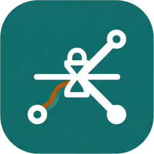
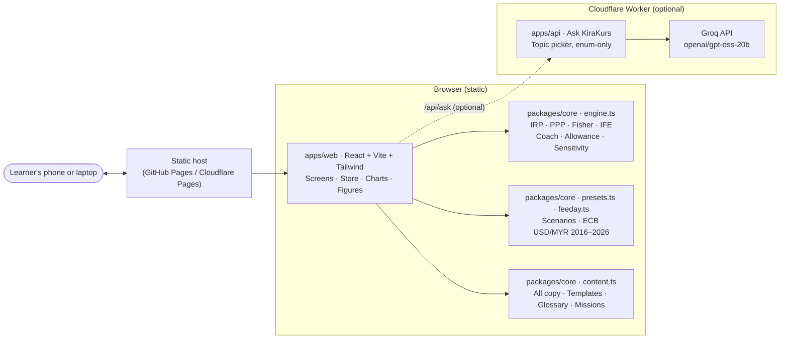

<p align="center">
  <picture>
    <source media="(prefers-color-scheme: dark)" srcset="docs/assets/logo-dark.png">
    
  </picture>
</p>

<h1 align="center">KiraKurs</h1>

<p align="center">
  <b>Convert Now or Later?</b><br>
  <sub>(<i>Kira</i> = calculate, <i>kurs</i> = exchange rate)</sub><br>
  See how inflation and interest rates move your ringgit before you pay abroad.
</p>

<p align="center">
  
  
  
</p>

<p align="center"><sub>built with</sub></p>

<p align="center">
  
  
  
  
  
  
  
  
</p>

<p align="center"><sub>GFB3043/GEB3043 International Financial Management · FinBridge AI Project</sub></p>

---

## Contents

1. [The problem](#the-problem)
2. [What KiraKurs does](#what-kirakurs-does)
3. [Scenarios (the numbers)](#scenarios-the-numbers)
4. [Learning objectives](#learning-objectives)
5. [Getting started](#getting-started)
6. [Architecture](#architecture)
7. [How the engine works](#how-the-engine-works)
8. [AI features](#ai-features)
9. [Design, motion and accessibility](#design-motion-and-accessibility)
10. [Testing](#testing)
11. [Status (honest)](#status-honest)
12. [Privacy & security](#privacy--security)
13. [Sources & academic integrity](#sources--academic-integrity)
14. [Team](#team)
15. [License](#license)

---

## The problem

Malaysian students who must pay a foreign-currency bill on a known future date (an exchange semester, a postgraduate deposit, an exam fee, a monthly allowance) **do not know why the ringgit cost changes**, how Malaysian and foreign inflation and interest rates feed into it, or that **locking the rate removes risk while waiting is a bet**.

<div align="center">

| Fact | Impact |
|---|---|
| The same US\$12,000 cost **RM 57,570** on 20 Feb 2024 and **RM 46,632** on 26 Feb 2026 (ECB reference rates) | An RM 10,938 swing on the same bill |
| Over **50,000 Malaysian students** study abroad | Many face this decision with no framework |
| Malaysians aged 19–30 score **below** the national financial-literacy average (The Star, 23 Nov 2025, on BNM MYFLIC data) | The knowledge gap is real |

</div>

**Why existing tools fall short:** Xe and Wise rate alerts tell you *when* a rate is hit, not *why* it moves or what waiting risks; tuition-payment services (CurrencyFair, Pay4Me) are payment rails; textbook formulas are disconnected from a real decision; chat assistants give unverified numbers. We found no student tool that links inflation, interest rates and exchange rates (IRP, PPP, Fisher, IFE) to the one question a student actually faces: **lock the rate now, or wait?**

## What KiraKurs does

**KiraKurs is a learning web app that turns parity theory into a decision.** It follows a fictional student, Aina (21, computer science, a US\$12,000 exchange-semester bill due in 270 days), and lets learners see, move and play with every number behind her choice.

<div align="center">

| Screen | Path | What the learner gets |
|---|---|---|
| **Welcome** | `/welcome` | A scroll story: the real 2016–2026 USD/MYR line forking into a *lock* path and a *wait* range, Aina's bill, a one-tap Fee Day taster, the four theories and the four stops |
| **Pre-check** | `/precheck` | 8-item quiz (forms A/B, counterbalanced) with confidence ratings, measuring prior knowledge; anonymous and skippable |
| **Learn** | `/learn` | Aina's story in 4 steps (spot → PPP → IRP → convert-now), each with its worked formula; then a commit-then-move slider task that reveals the answer only at the target |
| **Predict** | `/predict` | A direction question with misconception feedback; the learner commits before seeing the answer |
| **Parity Map** | `/map` | Sliders for inflation, interest, days and amount; a reference-rates table (bank lock, prices theory, interest theory, real rates) with arrows and plain-language reasons; linked (Fisher) mode; Kira explains every change; "Show the maths" substitutes every value |
| **Decision Coach** | `/coach` | Lock vs Wait in ringgit, the 8-of-10 historical range, a split slider, "use my own bill", monthly allowance, fees, a sensitivity chart with the break-even line, and a verdict from the real-rate rule |
| **Play** | `/play` | Five missions (flip the bank lock, weaken the ringgit, find break-even, link interest to inflation, feel the risk) with a 3-step hint ladder; **Fee Day** replays real past 270-day periods (lock / wait / half) |
| **Check** | `/check` | Sensitivity table (you-are-here row, break-even), then the post-check with feedback, per-objective bars and a result code |

</div>

**Guided vs free mode.** First-time visitors go Welcome → Pre-check → Learn → Predict, with a progress bar. After Learn (or "Skip to the Parity Map") the tab bar unlocks every screen. Lecturers can deep-link straight into free mode, e.g. `/map?preset=classroom` or `/coach?preset=snapshot&maths=1`.

**Kira, the hint guide.** A non-AI helper on the Map and Play screens. After every input change it states what moved, in which direction and why (e.g. *"You raised Malaysian interest to 5.00%. Bank lock: RM 4.0890 (up)…"*), all from engine output.

**Fee Day.** Uses 2,778 real ECB USD/MYR reference rates (4 Jan 2016 → 6 Nov 2026). Each round picks a random start date; the period ends on the first data day at least 270 days later. *Lock* = the period's starting rate × (1 + the 6 Nov 2026 forward premium), labelled illustrative because historical interest rates are not in the project. Results are framed as **risk taken**, never as wins.

**Permanent boundaries:** no accounts, no analytics, no cookies, no live rates, no financial advice. Parity theory, not a prediction.

## Scenarios (the numbers)

The scenario picker (calendar chip in the top bar) loads a full set of inputs into every screen. Dated scenarios are **frozen** on the day shown, carry a data badge everywhere, and are never called "today", "current" or "live" (a test enforces this).

<div align="center">

| Scenario | Ringgit per US\$1 | Interest MY / US | Inflation MY / US | Sources |
|---|---|---|---|---|
| **1 · Classroom** (illustrative) | 4.50 | 3.00% / 4.50% | 2.0% / 3.0% | Round numbers for practising by hand; 365 days |
| **2 · Snapshot 6 Nov 2026** (default) | 4.0565 | 2.75% / 3.875% | 1.8% / 3.7% | Bernama close 6 Nov; BNM MPS 5 Nov; FOMC 28 Oct; DOSM & BLS CPI Sep 2026 |
| **3 · Snapshot 6 Nov 2025** | 4.1830 | 2.75% / 3.875% | 1.5% / 3.0% | ECB 6 Nov 2025; BNM MPS 6 Nov 2025; FOMC 29 Oct 2025; DOSM & BLS CPI Sep 2025 |
| **4 · Snapshot 20 Feb 2024** | 4.7975 | 3.00% / 5.375% | 1.5% / 3.1% | ECB 20 Feb 2024 (weakest ringgit in the data); BNM MPS 24 Jan 2024; FOMC 31 Jan 2024; DOSM Dec 2023; BLS Jan 2024 |

</div>

US interest is the midpoint of the Fed funds target range. Each dated scenario's "8 of 10 past periods" range uses only 270-day periods that had **ended by that date** (`evidence/fx/band.py`), so it shows what was knowable on the day. All URLs are in [`docs/SOURCES.md`](docs/SOURCES.md) §A and §F.

## Learning objectives

After using KiraKurs, a learner can:

1. State how relative inflation moves the expected exchange rate (**PPP**).
2. Explain why a forward follows from interest rates and is a lock, not a forecast (**IRP**).
3. Relate nominal rates to inflation and real rates (**Fisher**), and say when PPP and IFE agree.
4. Use the **real-rate rule** to judge lock vs wait, see that waiting carries risk, and name two limitations.
5. Explain why, under PPP, a foreign living allowance in ringgit grows at **Malaysian** inflation.

---

## Getting started

A **pnpm workspace**: `packages/core` (finance engine and copy, pure TypeScript, zero runtime deps), `apps/web` (Vite + React) and `apps/api` (Cloudflare Worker). One command starts everything.

### 1. Prerequisites

<div align="center">

| Tool | Version | Install |
|---|---|---|
| Node.js | ≥ 20 (22+ recommended) | [nodejs.org](https://nodejs.org) or `nvm install 22` |
| pnpm | 12.x (pinned in `package.json`) | `corepack enable` |

</div>

### 2. Install and run

```bash
git clone https://github.com/No0bmazt3r/KiraKurs.git
cd KiraKurs
pnpm install          # once
pnpm dev              # web on http://localhost:5173 + API (wrangler dev) on :8787
```

Open http://localhost:5173. A first visit lands on `/welcome`; returning visitors go to `/learn`. The logo always returns to the welcome page.

### 3. Configuration

<div align="center">

| Setting | Where | Purpose |
|---|---|---|
| `GROQ_API_KEY` | `apps/api/.env` (copy from `apps/api/.env.example`; gitignored) | Enables Ask locally. Without it the API returns the topic menu |
| `ALLOWED_ORIGIN` | `apps/api/.env` locally (`http://localhost:5173`); `wrangler.toml` in production | The only site the Worker answers. Wrong value = every question gets the topic menu |
| `VITE_ASK_URL` | `apps/web/.env.production` (copy from `apps/web/.env.example`) or the CI repository variable | Deployed Worker URL. Empty = Ask hidden in production builds |
| `BASE` | build-time env | Sub-path hosting, e.g. `BASE=/KiraKurs/ pnpm build` for a GitHub Pages project site |

</div>

### 4. Commands

<div align="center">

| Command | What it does |
|---|---|
| `pnpm dev` | Web app and API together |
| `pnpm test` | Vitest: engine golden values and identities, wording guard, placeholders, format, quiz, missions, Fee Day, snapshot data |
| `pnpm typecheck` | Strict TypeScript across all packages |
| `pnpm e2e` | Production build + headless-Chrome walkthrough (guided flow at 375 px, golden numbers on screen, Play, deep links, themes, no sideways scroll). Set `CHROME_PATH` if Playwright's Chromium is not installed |
| `pnpm build` | Production build → `apps/web/dist` (also writes `404.html` for deep links on static hosts) |

</div>

### 5. Repository layout

```
KiraKurs/
├── package.json  pnpm-workspace.yaml  tsconfig.base.json  vitest.config.ts
├── packages/core/              pure TypeScript, shared by web and API, no runtime deps
│   ├── src/engine.ts           finance only: IRP, PPP, Fisher, IFE, coach, allowance, sensitivity, validation
│   ├── src/presets.ts          the four scenarios (sourced; never edited in place)
│   ├── src/feeday.ts           Fee Day replay, play style, month-end history for the welcome charts
│   ├── src/usdmyr.json         ECB USD/MYR reference rates 2016-01-04 → 2026-11-06
│   ├── src/content.ts          every user-facing string, glossary tips, quiz, missions, Kira
│   ├── src/format.ts           Intl formatting, % ↔ decimal, signed values
│   ├── src/quiz.ts             scoring and result code
│   ├── src/ask.ts              Ask topic ids + PII guard
│   └── test/                   Vitest suites + engine.version.json (engine hash guard)
├── apps/web/                   Vite + React 19 + Tailwind v4
│   ├── index.html              first-paint skeleton, fonts, icons
│   ├── src/main.tsx            boot (old #/ links, presets, first-visit routing), lazy routes
│   ├── src/Shell.tsx           top bar, scenario picker, tabs, progress, action bar, footer
│   ├── src/store.ts            Zustand store + localStorage persistence
│   ├── src/ui.tsx              Field, Choices, Rich (glossary), Live (count-up), Badge, Kira, Sheet, skeletons
│   ├── src/chart.tsx           inline-SVG sensitivity chart
│   ├── src/figures.tsx         rigged SVG figures with looping motion
│   ├── src/tw.ts               Tailwind class recipes for shared building blocks (cn = tailwind-merge)
│   ├── src/styles.css          Tailwind theme tokens, element defaults, motion only
│   ├── src/screens/            Welcome Precheck Learn Predict Map Coach Play Check Quiz Ask
│   ├── public/                 app icons (light/dark), apple-touch icon
│   └── e2e/smoke.ts            headless-Chrome smoke test
├── apps/api/                   Cloudflare Worker: Ask KiraKurs
├── docs/                       PRD ENGINE ARCHITECTURE UX-FLOWS DESIGN CONTENT TASKS TESTING SOURCES
├── public/team/                team photos
├── AGENTS.md                   build rules
└── LICENSE                     MIT
```

---

## Architecture

A **static single-page app** with an optional serverless API. No database, no accounts, no backend state.



- **Every number on screen comes from `engine.ts`** (or the dated ECB series for history). No number is hard-coded in HTML, CSS or copy; templates use `{{placeholders}}` filled by `makeVars()`.
- **Full precision inside, rounding only at display** (`format.ts`). Rates are decimals inside, percent in the UI. Quote convention everywhere: ringgit per 1 unit of foreign currency, "↑ = ringgit weaker".
- **Routing:** clean paths (`/learn`) with TanStack Router; old `#/learn` links are rewritten on load; unknown paths go to Learn (or Welcome on a first visit). Each screen is a separate chunk loaded on demand.
- **Deployment:** any static host. `pnpm build` copies `index.html` to `404.html` so deep links work on GitHub Pages; use `BASE=/KiraKurs/` for a project site. The GitHub Actions workflow was removed, so deployment is currently manual.

### Data flow

```
user input → Field (parse via format.ts) → store.setRaw(patch)
                                            │
                      engine.validate(raw) ─ errors → message next to the field
                                            │ ok
                      engine.parityMap / coach / allowance / sensitivity   (pure, microseconds)
                                            │
                      makeVars() → content templates → screen render (count-up on big numbers)
```

### Tech stack

<div align="center">

| Layer | Choice |
|---|---|
| Engine | Pure TypeScript, zero deps |
| App | React 19, Vite 8, TanStack Router (clean paths, lazy routes, view transitions), Zustand (persisted) |
| Styling | Tailwind CSS v4 via `@tailwindcss/vite`: utilities in every component, shared recipes in `src/tw.ts` merged with `tailwind-merge`, semantic colour tokens for light/dark |
| Charts, icons, figures | Inline SVG only (Lucide icon bodies, ISC); figures animated with SVG `<animateTransform>` |
| Font | IBM Plex Sans (Google Fonts, OFL), tabular figures |
| API | Cloudflare Worker + Groq `openai/gpt-oss-20b`, rate-limited, enum-only replies |
| Tests | Vitest; headless Chrome via `playwright-core` |

</div>

---

## How the engine works

`packages/core/src/engine.ts` (version **1.2.1**, guarded by a hash test) implements the textbook parity formulas as pure functions. Rates are annual effective decimals, compounded over `t = n/365`.

<div align="center">

| Formula | What it computes |
|---|---|
| **Covered IRP** | `F = S · ((1+iH)/(1+iF))^t` — the forward: a lock, not a forecast |
| **Relative PPP** | `E_ppp = S · ((1+πH)/(1+πF))^t` — where relative prices say the rate should go |
| **IFE / UIP** | `E_ife = S · ((1+iH)/(1+iF))^t` — so `E_ife ≡ F` exactly |
| **Fisher (exact)** | `r = (1+i)/(1+π) − 1` — the real interest rate |
| **Break-even πH** | `πH* = (1+iH)(1+πF)/(1+iF) − 1` — where rH = rF and lock = wait |
| **Coach A** (lock / convert now) | `A = S·T / (1+iF)^t` |
| **Coach C** (wait, PPP) | `C_ppp = E_ppp·T / (1+iH)^t` |
| **Historical range** | `C_rw · (1+q10) … C_rw · (1+q90)`, q from 270-day ECB moves since 2016 |
| **Split** | `h·A + (1−h)·C` for 0 ≤ h ≤ 1 |
| **Real-rate rule** | `sign(C_ppp − A) = −sign(rH − rF)` — the one-line verdict |

</div>

**Key identity:** when real rates are equal (rH = rF), PPP and IFE agree and lock = wait (the break-even line on the chart).

**Golden values** (ENGINE.md §7) are asserted with relative tolerance 1e-9. Scenario 2 at 270 days: Lock RM 47,328.10 · Wait (PPP) RM 47,062.68 · Random walk RM 47,710.88 · Range RM 44,291.80 – RM 50,987.10.

**Validation:** amounts, days and rates are checked with a message beside the field (split must be 0–100%); rates beyond −10% or 50% show a warning that results may be extreme.

---

## AI features

**Not a chatbot.** The AI never writes text the learner reads and never produces a result. It only *routes* (picks one id from a fixed list) or *reads* (copies numbers the learner typed). Every sentence was written by the team; every result comes from `engine.ts`. One Cloudflare Worker (`apps/api`) serves all three tasks with Groq (`openai/gpt-oss-20b`, temperature 0, strict JSON schema), 10 requests per minute per IP, key kept on the Worker.

<div align="center">

| Feature | Where | The AI returns | Deterministic guard | If AI is off or fails |
|---|---|---|---|---|
| **Ask KiraKurs** | Learn, Map, Coach, Check | one of 20 explanation ids | Worker rejects any id not in the list; app fills the team's template with engine numbers | menu of the 20 questions |
| **Explain your thinking** | Predict, after answering | one of 7 reasoning ids (e.g. `expects_rate_hike`, `quote_flip`) | enum only; feedback is team-written and misconception-specific | pick-list of the 7 lines of thinking (always shown) |
| **Describe your bill** | Coach → Use my own bill | amount, period and unit copied from the text | `billFromParse`: each number must appear in the learner's text; days are computed in code (months × 365/12); then `engine.validate` | "couldn't find" message; the manual fields stay |

</div>

Before anything is sent, the browser blocks text that looks like personal data (email, phone, IC, passport, account number). Status: works locally with `pnpm dev` and `GROQ_API_KEY` in `apps/api/.env`; hidden in production builds until the Worker is deployed (`wrangler deploy`, `wrangler secret put GROQ_API_KEY`) and the site is built with `VITE_ASK_URL`. Without it, Predict still shows the reasoning pick-list.

---

## Design, motion and accessibility

- **Look:** IBM Plex Sans, a teal/amber palette taken from the logo (teal = lock and certainty, amber = wait and risk), square-ish corners, tone steps instead of shadows, full-width responsive layouts (up to ~110 rem), and a fluid root font size so the whole UI scales with the window.
- **Light and dark** themes from one set of semantic tokens; follows the system, with a toggle (cross-fades between themes).
- **Welcome page:** content flows in and out with the scroll position (CSS scroll-driven animations), the history chart draws as you scroll, figures drift at a slower pace for depth; the hero chart forks into the lock path and wait range.
- **Figures:** flat, rigged SVG people (shoulder/elbow, hip/knee joints) with gentle loops: breathing, head tilts, a walk cycle whose stride matches its speed, an hourglass sway, cheering. Decorative only (`aria-hidden`).
- **Motion elsewhere:** cross-fade between screens (View Transitions), count-up on big numbers, accordions that slide open, entrances for steps, hints, feedback and Kira messages.
- **Loading:** a first-paint skeleton in `index.html`, a screen-shaped skeleton while a screen's code loads, and line skeletons while Ask waits.
- **Accessibility:** visible labels, keyboard operable (radio groups with arrow keys), visible focus, 44 px touch targets, contrast ≥ 4.5:1, glossary terms as buttons, live regions for verdicts and Kira, tables as alternatives to charts, no horizontal scroll at 375 px. **`prefers-reduced-motion` turns every animation off** and figures stand still.

---

## Testing

<div align="center">

| Suite | Checks |
|---|---|
| `engine.test.ts` | Golden values G1–G7 and both original scenarios, identities (E_ife ≡ F, break-even), validation and hints, engine version hash |
| `content.test.ts` | No "today/current/latest/live" wording; "now" only as "set aside / convert now"; every `{{placeholder}}` resolves for every scenario; glossary and mission copy |
| `format.test.ts` | Rounding, percent ↔ decimal, signs |
| `play.test.ts` | Fee Day windows and arithmetic, Kira explanations, equal-rate wording, missions, welcome history, snapshot rates equal the ECB value on their date |
| `e2e/smoke.ts` | Full guided flow on a 375 px phone, golden numbers on screen, linked mode, validation, Play (missions, 3 Fee Day rounds), Check, deep links, old hash links, dark theme, no sideways scroll, no console errors |

</div>

All 34 unit tests and the browser walkthrough pass on the current `main`.

---

## Status (honest)

<div align="center">

| What | Status |
|---|---|
| App (all screens, Play, Welcome, four scenarios) | Built; unit tests and browser walkthrough pass |
| Engine golden values | Pass (G1–G7, Scenario 1, Scenario 2, sensitivity, identities) |
| Independent spreadsheet cross-check (`evidence/numbers.xlsx`) | **Not yet done** — a team member must rebuild the formulas in Excel and log the result |
| Source check by a team member | In progress: see `docs/SOURCES.md` (panel-opened ≠ member-checked) |
| Pre/post learning results, think-aloud usability | **Not yet conducted** — report only what is observed |
| Public deployment | **Not deployed** (Pages workflow removed); see Architecture → Deployment |
| AI features (Ask, Explain your thinking, Describe your bill) | Built and unit-tested with a mocked model; not yet run against Groq with a real key; hidden in production until the Worker is deployed |
| Poster, video, report | Separate deliverables, not in this repository |

</div>

---

## Privacy & security

No accounts, no analytics, no cookies. The only network requests are Google Fonts and, if enabled, the Ask Worker, which receives only the typed question after a personal-data check (Cloudflare may log requests). Quiz answers, missions and Fee Day rounds stay in `localStorage`; "Clear my data" in the footer deletes them. The result code is shown and copied, never sent. User and AI text is never inserted as HTML. API keys live only in the Worker's secrets or the gitignored `apps/api/.env`.

## Sources & academic integrity

Every dated value cites its source (BNM, Federal Reserve, DOSM, BLS, ECB, Bernama). The full list with exact URLs and verification status is in [`docs/SOURCES.md`](docs/SOURCES.md); a named team member must still open each source and log it. **AI use:** the idea, specs and the application code were generated with Claude Code (Anthropic) from the spec documents and are reviewed by the team; the optional Ask feature uses Groq (`openai/gpt-oss-20b`) only to pick a topic id. See SOURCES.md §E. No test result, survey number or quote in this project is invented.

---

## Team

<div align="center">
<table>
  <tr>
    <td align="center" width="20%"><br><b>Danish Iskandar bin Mohammad Iskandar</b><br><sub>22006685</sub></td>
    <td align="center" width="20%"><br><b>Muhammad Danish Alif Bin Azrul</b><br><sub>22006390</sub></td>
    <td align="center" width="20%"><br><b>Muhammad Zaid bin Zamri</b><br><sub>22005020</sub></td>
    <td align="center" width="20%"><br><b>Aiman Rusyaidi bin Rohazlan</b><br><sub>22006646</sub></td>
    <td align="center" width="20%"><br><b>Sharvin A/L Kanesan</b><br><sub>22006930</sub></td>
  </tr>
</table>
</div>

## License

[MIT](LICENSE) © 2026 Sharvin A/L Kanesan and the KiraKurs team.
