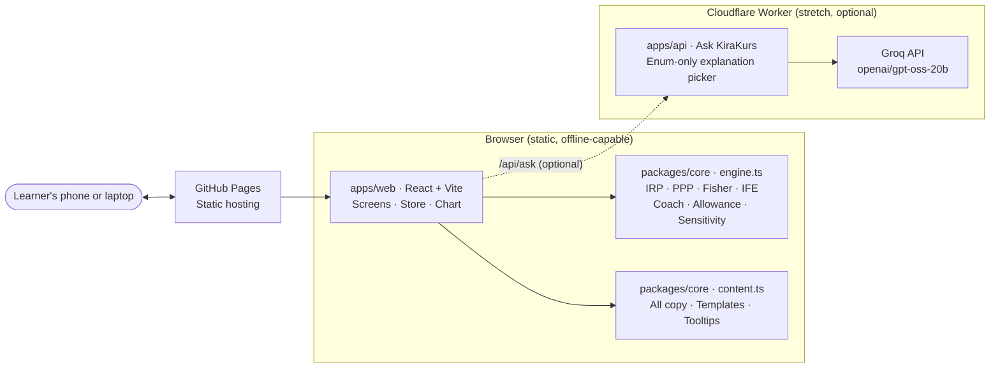

<h1 align="center">KiraKurs</h1>

<p align="center">
  <b>Convert Now or Later?</b><br>
  <sub>(<i>Kira</i> = calculate, <i>kurs</i> = exchange rate)</sub><br>
  See how inflation and interest rates move your ringgit before you pay abroad.
</p>

<p align="center">
  
  
  
</p>

<p align="center"><sub>built with</sub></p>

<p align="center">
  
  
  
  
  
  
  
  
</p>

<p align="center"><sub>GFB3043/GEB3043 International Financial Management · FinBridge AI Project</sub></p>

---

## Contents

1. [The problem](#the-problem)
2. [Our solution](#our-solution)
3. [Learning objectives](#learning-objectives)
4. [Getting started](#getting-started)
5. [Architecture](#architecture)
6. [How the engine works](#how-the-engine-works)
7. [Results (honest status)](#results-honest-status)
8. [Privacy & security](#privacy--security)
9. [Sources & academic integrity](#sources--academic-integrity)
10. [Team](#team)
11. [License](#license)

---

## The problem

Malaysian students who must pay a foreign-currency bill on a known future date — an exchange semester, a postgraduate deposit, an exam fee, a monthly allowance — **do not know why the ringgit cost changes**, how Malaysian vs foreign inflation and interest rates feed into it, or that **locking the rate removes risk while waiting is a bet**.

<div align="center">

| Fact | Impact |
|---|---|
| The same US\$12,000 cost **RM 57,570** on 20 Feb 2024 and **RM 46,632** on 26 Feb 2026 | A RM 10,938 swing on the same bill |
| Over **50,000 Malaysian students** study abroad | Many face this decision with no framework |
| Young Malaysians (19–30) score **below** the national financial literacy average (MYFLIC) | The knowledge gap is real |

</div>

**Why existing tools fall short:** Xe and CurrencyFair show rates but don't explain *why* they move; textbook formulas are abstract and disconnected from a real decision; no tool links inflation, interest rates and exchange rates (IRP, PPP, Fisher, IFE) to one question the student actually faces: **lock the rate now, or wait?**

## Our solution

**KiraKurs is a learning web app that turns parity theory into a decision.** Through a fictional student (Aina, 21, CS major, US\$12,000 exchange semester in 270 days), learners see how inflation and interest rates flow into exchange rates, and then use those numbers to judge lock vs wait — with the risk made visible.

<div align="center">

| Screen | What the learner gets |
|---|---|
| **Pre-check** | 8-item quiz (forms A/B, counterbalanced) measuring what they know before starting |
| **Learn** (Aina's story) | A 4-step worked example linking spot rates → PPP → IRP → Fisher, building the answer piece by piece |
| **Predict** | A direction question with misconception feedback — the learner commits before seeing the answer |
| **Parity Map** | Four live numbers (forward, PPP, IFE, real rates) responding to input changes; linked mode holds real rates and shows how inflation flows through; "Show the maths" reveals every formula with substituted values |
| **Decision Coach** | Lock (A) vs Wait (C) in ringgit, three forecasts, a historical range, a split slider, a margin input, and an honest verdict from the real-rate rule |
| **Sensitivity + Post-check** | An inflation slider with a break-even line and chart; then the same quiz again to measure what changed |

</div>

**Two presets, one click:** **Scenario 1 · Classroom** uses illustrative numbers (S 4.50, iH 3%, iF 4.5%). **Scenario 2 · Snapshot 6 Nov 2026** uses dated real-world data (OPR 2.75%, Fed funds 3.875%, Malaysian CPI 1.8%, US CPI 3.7%). Every Snapshot value carries a data badge and is never called "today" or "live".

**Stretch features (built if time allows):** GBP/AUD presets, PWA offline support, and an "Ask KiraKurs" AI router (enum-only explanation picker on Groq via a Cloudflare Worker, hidden in production unless `VITE_ASK_URL` is set).

**Permanent boundaries:** no accounts, no analytics, no cookies, no live rates, no financial advice. Quiz answers stay in `localStorage`. Parity theory, not a prediction.

## Learning objectives

After using KiraKurs, a learner can:

1. State how relative inflation moves the expected exchange rate (**PPP**).
2. Explain why a forward follows from interest rates and is a lock, not a forecast (**IRP**).
3. Relate nominal rates to inflation and real rates (**Fisher**), and say when PPP and IFE agree.
4. Use the **real-rate rule** to judge lock vs wait, see that waiting carries risk, and name two limitations.
5. Explain why, under PPP, a foreign living allowance in ringgit grows at **Malaysian** inflation.

---

## Getting started

This is a **pnpm workspace**: `packages/core` (the finance engine, pure TypeScript, zero runtime deps), `apps/web` (Vite + React), and `apps/api` (Cloudflare Worker). One command starts everything.

### 1. Prerequisites

<div align="center">

| Tool | Version | Install |
|---|---|---|
| Node.js | ≥ 20 | [nodejs.org](https://nodejs.org) or `nvm install 20` |
| pnpm | 12.x (pinned in `package.json`) | `corepack enable` |

</div>

### 2. Install and run

```bash
git clone https://github.com/No0bmazt3r/KiraKurs.git
cd KiraKurs
pnpm install          # once
pnpm dev              # web on http://localhost:5173 + API (wrangler dev) on :8787
```

Open http://localhost:5173. First-time visitors see a welcome intro, then the pre-check quiz, then Aina's story. Lecturers can deep-link with `?preset=classroom` or `?preset=snapshot&maths=1`.

### 3. Configuration

For the **Ask** feature locally, copy `apps/api/.dev.vars.example` to `apps/api/.dev.vars` and add a Groq key (never commit it). Without a key the API runs and always returns the topic menu.

### 4. Commands

<div align="center">

| Command | What it does |
|---|---|
| `pnpm dev` | Starts the web app and the API together |
| `pnpm test` | Vitest: engine golden values, identities, content wording guard, format, quiz, API |
| `pnpm typecheck` | Strict TypeScript across all packages |
| `pnpm e2e` | Build + headless-Chrome smoke test (golden numbers on screen, 375 px, themes, deep links) |
| `pnpm build` | Production build → `apps/web/dist` |

</div>

### 5. Repository layout

```
KiraKurs/
├── package.json  pnpm-workspace.yaml  tsconfig.base.json  vitest.config.ts
├── packages/core/             pure TypeScript, shared by web and API, no runtime deps
│   ├── src/engine.ts          finance only: IRP, PPP, Fisher, IFE, coach, allowance, sensitivity
│   ├── src/presets.ts          Classroom and Snapshot data
│   ├── src/format.ts          Intl formatting, % ↔ decimal, signed values
│   ├── src/content.ts          all user-facing copy and templates (mirrors CONTENT.md)
│   ├── src/quiz.ts            quiz scoring and result code
│   ├── src/ask.ts             Ask ids + PII guard
│   └── test/                  Vitest suites + engine.version.json
├── apps/web/                  Vite + React
│   ├── src/main.tsx           boot: legacy hash links, presets, TanStack Router
│   ├── src/Shell.tsx          top bar, tabs, progress, action bar, footer
│   ├── src/store.ts           Zustand store + localStorage persistence
│   ├── src/ui.tsx             shared UI components
│   ├── src/chart.tsx          inline-SVG sensitivity chart
│   ├── src/screens/           Precheck Learn Predict Map Coach Check Quiz Ask
│   └── e2e/smoke.ts          headless-Chrome smoke test
├── apps/api/                  Cloudflare Worker: Ask KiraKurs (stretch)
├── docs/                      PRD, ENGINE, ARCHITECTURE, UX-FLOWS, DESIGN, CONTENT, TASKS, TESTING, SOURCES
├── public/team/               team photos
├── AGENTS.md                  build spec for AI agents
└── LICENSE                    MIT
```

---

## Architecture

KiraKurs is a **static single-page app** with an optional serverless API. No database, no accounts, no backend state.



- **Every number on screen comes from `engine.ts`.** No number is hard-coded in HTML, CSS, or copy. The engine is pure: no DOM, no I/O, no dependencies.
- **Recompute on every change.** The engine runs in microseconds; there are no caches or partial updates.
- **The AI (stretch) picks explanations, never computes.** It returns an `explanation_id`; the client renders the template from `content.ts`. No user data reaches the AI.
- **Deployment:** GitHub Pages via GitHub Actions. `pnpm build` with `BASE=/KiraKurs/` for a project site. Deep links work via `404.html`.

### Data flow

```
user input → ui (parse via format.ts) → store.set(patch)
                                          │
                    engine.validate(raw) ─ errors → field messages
                                          │ ok
                    engine.parityMap/coach/allowance(values)  (pure, ~µs)
                                          │
                    screen.render(state, results) → DOM
```

### Tech stack

<div align="center">

| Layer | Choice |
|---|---|
| Engine | Pure TypeScript, zero deps: IRP, PPP, Fisher, IFE, coach, allowance, sensitivity, validation |
| App | React 19, Vite, TanStack Router (clean paths), Zustand, Tailwind CSS v4 (`@tailwindcss/vite`) |
| Charts & icons | Inline SVG (no chart library, no icon library at runtime; Lucide SVG bodies, ISC) |
| API (stretch) | Cloudflare Worker, Groq (`openai/gpt-oss-20b`), enum-only responses |
| Tests | Vitest (engine, content, format, quiz, API), Playwright-style headless-Chrome e2e |
| Hosting | GitHub Pages (static), Cloudflare Workers (optional API) |
| Fonts | Inter, Plus Jakarta Sans / IBM Plex Sans (Google Fonts, OFL) |

</div>

---

## How the engine works

The engine (`packages/core/src/engine.ts`) implements the textbook parity formulas as pure functions. All rates are annual effective decimals, compounded over `t = n/365`. Nothing is approximated inside; rounding happens only at display in `format.ts`.

<div align="center">

| Formula | What it computes |
|---|---|
| **Covered IRP** | `F = S · ((1+iH)/(1+iF))^t` — the forward: a lock, not a forecast |
| **Relative PPP** | `E_ppp = S · ((1+πH)/(1+πF))^t` — where prices say the rate should go |
| **IFE / UIP** | `E_ife = S · ((1+iH)/(1+iF))^t` — so `E_ife ≡ F` exactly |
| **Fisher (exact)** | `r = (1+i)/(1+π) − 1` — real interest rate |
| **Break-even πH** | `πH* = (1+iH)(1+πF)/(1+iF) − 1` — where rH = rF and lock = wait |
| **Coach A** (convert now) | `A = S·T / (1+iF)^t` |
| **Coach C** (wait, PPP) | `C_ppp = E_ppp·T / (1+iH)^t` |
| **The real-rate rule** | `sign(C_ppp − A) = −sign(rH − rF)` — the one-line verdict |

</div>

**Key identity:** When real rates are equal (rH = rF), all forecasts agree and lock = wait. The sensitivity chart shows this as the break-even inflation rate.

**Golden values** (ENGINE.md §7) are asserted in tests with relative tolerance 1e-9. Scenario 2 at 270 days: Lock RM 47,328.10, Wait (PPP) RM 47,062.68, Random Walk RM 47,710.88, Historical range RM 44,291.80 – RM 50,987.10.

---

## Results (honest status)

<div align="center">

| What | Status |
|---|---|
| Engine golden values | **All tests pass** — G1–G7, Scenario 1, Scenario 2, sensitivity, identities |
| Excel cross-check | Human-verified against Madura (14th ed.) formulas in `evidence/numbers.xlsx` |
| Learning pre/post | **Report what is observed, or "not conducted"** — no fabricated results |
| Think-aloud usability | ≥ 5 students, logged as observed |
| Snapshot data | Dated 6 Nov 2026, sources panel-opened 15 Nov; **not live** |
| Ask KiraKurs (AI) | Stretch; returns explanation IDs only, no computed numbers |

</div>

---

## Privacy & security

No accounts, no analytics, no cookies, no network calls (except Google Fonts and the optional Ask Worker, which receives only the typed question). Quiz answers stay in `localStorage`. A "Clear my data" link sits in the footer. The result code is shown and copied, never sent. Never `innerHTML` with user or AI strings.

## Sources & academic integrity

Every Snapshot value cites its source (BNM, Federal Reserve, BLS, DOSM, ECB). The full citation list with verification status is in [`docs/SOURCES.md`](docs/SOURCES.md). Engine code was generated by AI from the spec documents and **verified by the team** against Excel and the textbook (Madura, 14th ed.). See the AI-use disclosure in SOURCES.md §E.

---

## Team

<div align="center">
<table>
  <tr>
    <td align="center" width="20%"><br><b>Danish Iskandar bin Mohammad Iskandar</b><br><sub>22006685</sub></td>
    <td align="center" width="20%"><br><b>Muhammad Danish Alif Bin Azrul</b><br><sub>22006390</sub></td>
    <td align="center" width="20%"><br><b>Muhammad Zaid bin Zamri</b><br><sub>22005020</sub></td>
    <td align="center" width="20%"><br><b>Aiman Rusyaidi bin Rohazlan</b><br><sub>22006646</sub></td>
    <td align="center" width="20%"><br><b>Sharvin A/L Kanesan</b><br><sub>22006930</sub></td>
  </tr>
</table>
</div>

## License

[MIT](LICENSE) © 2026 Sharvin A/L Kanesan and the KiraKurs team.
